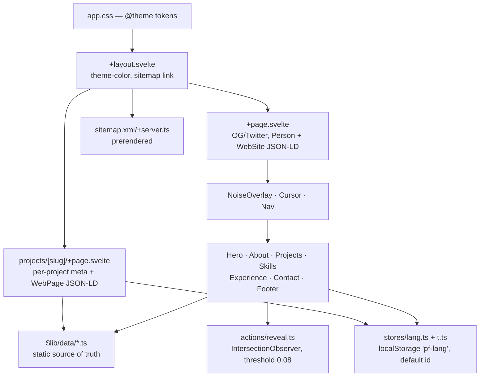

# portfolio-claude

Personal portfolio site for **Fadhil Andriawan** — [fadhil-andriawan.dev](https://fadhil-andriawan.dev).

A bilingual (Indonesian / English) single-page portfolio plus a set of static project
detail pages, built as a fully prerendered static site and deployed to Cloudflare Pages.

## Stack

| Layer | Choice |
|---|---|
| Framework | SvelteKit 2 + Svelte 5 (runes mode) |
| Language | TypeScript 6 (strict) |
| Styling | Tailwind CSS v4 (`@theme` in `src/app.css`, no config file) |
| Build | Vite 8 + `@sveltejs/adapter-static` (SSG) |
| Runtime | None — every route is prerendered at build time |
| Hosting | Cloudflare Pages (`wrangler.jsonc`, headers in `static/_headers`) |
| Package manager | bun |

## Commands

| Command | What it does |
|---|---|
| `bun dev` | Dev server |
| `bun run build` | Production build → `build/` |
| `bun run preview` | Preview the production build locally |
| `bun test` | Run the `bun:test` suite in `tests/` |
| `bun run check` | Typecheck via `svelte-check` (runs `svelte-kit sync` first) |
| `bun run check:watch` | Same, in watch mode |
| `bun run deploy` | `wrangler pages deploy` the `build/` output |

`bun run prepare` (aliased into `check`) generates `.svelte-kit/tsconfig.json`, which must
exist before typechecking.

## Architecture



- **All routes prerender.** `src/routes/+layout.ts` sets `export const prerender = true`;
  `[slug]/+page.ts` supplies an `entries` generator so every project page is built.
- **Content is code, not a CMS.** Projects, skills, and experience live in
  `src/lib/data/`. Edit those files to change the site.
- **i18n is a client-side store.** `src/lib/stores/lang.ts` + `t.ts` read flat JSON
  dictionaries in `src/lib/i18n/{id,en}.json` and persist the choice to localStorage
  under `pf-lang`. Default is `en` (matching `<html lang="en">`); the store only reads
  storage in the browser, so prerendered HTML is always English and Indonesian visitors
  get a flash of English before hydration. Because language is never part of the URL,
  the served HTML is identical for every visitor — which is why the site emits no
  `hreflang` tags.
- **Structured data is injected with `{@html}` inside `<svelte:head>`**, not a plain
  `<script>` block, so Svelte does not HTML-escape the embedded JSON.
- **SEO**: canonical URLs, Open Graph + Twitter Card tags, JSON-LD, `robots.txt`,
  and a prerendered `sitemap.xml`. `lastmod` is deliberately omitted (see the comment in
  `+server.ts`).

## Statistics section

`Stats.svelte` renders two panels of externally fetched numbers — GitHub first, then
Duolingo. Everything is fetched **at prerender time**; the browser never calls either
service. Each source degrades independently into its committed snapshot.

| Piece | Where |
|---|---|
| GitHub types + pure helpers (`shapeCalendar`, `level`, `weekdayIndex`, `selectRecentActivity`, `mergeSnapshot`) | `src/lib/data/github.ts` |
| Duolingo types + pure helpers (`formatJoinDate`, `barPercent`) | `src/lib/data/duolingo.ts` |
| REST + GraphQL access, token passed in | `src/lib/server/github-api.ts` |
| Duolingo profile access, no token | `src/lib/server/duolingo-api.ts` |
| Env lookup + snapshot fallback | `src/lib/server/{github,duolingo}-stats.ts` |
| Prerender entry point | `src/routes/+page.server.ts` |
| Committed fallback snapshots | `src/lib/data/{github,duolingo}-stats.json` |

### Tokens

`GITHUB_TOKEN` is required at build time **only** for the GitHub contribution calendar and
the recent pull-request / issue list — both come from GraphQL `contributionsCollection`,
which is not readable anonymously. Stars, repository count, and the latest event use the
public REST API and work without it. Set the variable in Cloudflare Pages (Settings →
Environment variables, plain text, production **and** preview) and in `.env` for local dev.

Duolingo needs no token at all: its public profile document is readable anonymously.

If either fetch fails, the section falls back to the committed snapshot rather than
failing the build. Keep the snapshots fresh with:

```sh
bun run stats:refresh   # refreshes both; GitHub uses $GITHUB_TOKEN, else the local `gh` session
```

Numbers are stale between deploys, since Cloudflare Pages rebuilds on push.

### Caveats

- **Duolingo's API is undocumented and unversioned** (`/2017-06-30/users?username=`) and
  has already changed shape once — the by-ID endpoint no longer accepts usernames. If it
  breaks, the snapshot keeps the page rendering; fixing it means re-finding the endpoint.
- **Don't store the raw Duolingo payload.** It carries `location`, `hasPhoneNumber`,
  `emailVerified`, `hasGoogleId`, and `joinedClassroomIds`. `duolingo-api.ts` extracts only
  the seven fields the page displays.
- `crowns` reports the capped `9999` for every course and so is not shown.
- The activity column is capped at 5 items from a 90-day window, because GitHub returns
  pull requests and issues by *last updated*: an unrelated old issue touched recently
  would otherwise float to the top of a portfolio.

## Layout

```
src/
  app.css                 Tailwind entry + @theme tokens
  app.html                shell, font links
  routes/                 +layout, home, projects/[slug], sitemap.xml
  lib/
    actions/reveal.ts     scroll-reveal Svelte action
    components/           Cursor, GlitchText, LangToggle, NoiseOverlay, …
      sections/           Nav, Hero, About, Projects, Skills, Experience, Contact, Stats, Footer
    data/                 projects.ts, skills.ts, experience.ts, github.ts, duolingo.ts, *-stats.json
    i18n/                 id.json, en.json
    server/               github-api.ts, duolingo-api.ts + their -stats.ts wrappers (build-time)
    stores/               lang.ts, t.ts
scripts/                 refresh-github-stats.ts, refresh-duolingo-stats.ts
static/                   images, CV, favicons, _headers, robots.txt
tests/                    bun:test suite
_design-reference/        original single-file design mockup (visual source of truth)
```

## Conventions

- Svelte 5 runes only (`$props()`, `$state()`, `$derived()`, `{@render children()}`);
  runes mode is enforced in `svelte.config.js`.
- Section components take no props — they import their data from `$lib/data/` directly.
- Scripts use `<script lang="ts">` with scoped `<style>` blocks.
- Fonts: Space Grotesk (display) + JetBrains Mono (mono), loaded from Google Fonts.
- `cursor: none` on `body` is intentional (custom `Cursor.svelte`).
- `prefers-reduced-motion: reduce` is respected in global CSS.

## Testing

`bun test` runs four suites:

- `projects-localization.test.ts` — every project has both `en` and `id` values for each
  translatable field.
- `i18n-dictionaries.test.ts` — `id.json` and `en.json` define the same keys, none blank,
  and no Indonesian string was pasted under the English key. Worth knowing: `t()`
  silently returns the raw key on a miss, so a missing entry shows up as literal
  `stats.title` on the page rather than a build error.
- `github-stats.test.ts` — calendar shaping (weekday alignment, padding) and the
  intensity buckets.
- `duolingo-stats.test.ts` — join-date parsing and course bar scaling.

Add new projects with both languages or the suite fails.
