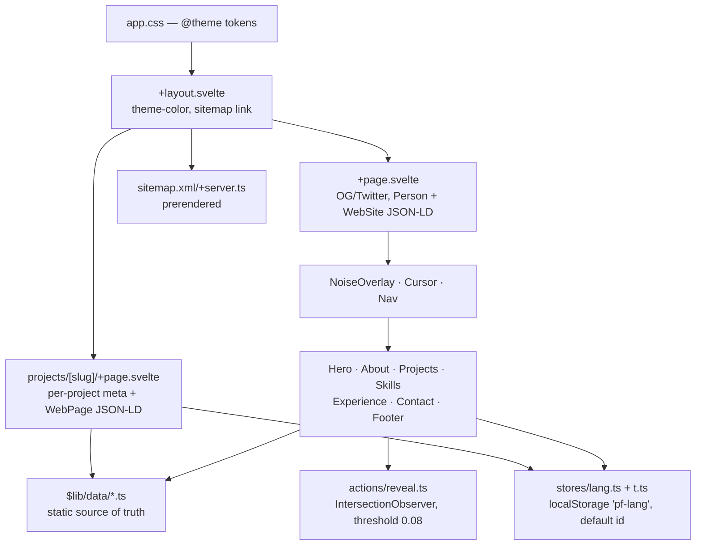

# portfolio-claude

Personal portfolio site for **Fadhil Andriawan** — [fadhil-andriawan.dev](https://fadhil-andriawan.dev).

A bilingual (Indonesian / English) single-page portfolio plus a set of static project
detail pages, built as a fully prerendered static site and deployed to Cloudflare Pages.

## Stack

| Layer | Choice |
|---|---|
| Framework | SvelteKit 2 + Svelte 5 (runes mode) |
| Language | TypeScript 6 (strict) |
| Styling | Tailwind CSS v4 (`@theme` in `src/app.css`, no config file) |
| Build | Vite 8 + `@sveltejs/adapter-static` (SSG) |
| Runtime | None — every route is prerendered at build time |
| Hosting | Cloudflare Pages (`wrangler.jsonc`, headers in `static/_headers`) |
| Package manager | bun |

## Commands

| Command | What it does |
|---|---|
| `bun dev` | Dev server |
| `bun run build` | Production build → `build/` |
| `bun run preview` | Preview the production build locally |
| `bun test` | Run the `bun:test` suite in `tests/` |
| `bun run check` | Typecheck via `svelte-check` (runs `svelte-kit sync` first) |
| `bun run check:watch` | Same, in watch mode |
| `bun run deploy` | `wrangler pages deploy` the `build/` output |

`bun run prepare` (aliased into `check`) generates `.svelte-kit/tsconfig.json`, which must
exist before typechecking.

## Architecture



- **All routes prerender.** `src/routes/+layout.ts` sets `export const prerender = true`;
  `[slug]/+page.ts` supplies an `entries` generator so every project page is built.
- **Content is code, not a CMS.** Projects, skills, and experience live in
  `src/lib/data/`. Edit those files to change the site.
- **i18n is a client-side store.** `src/lib/stores/lang.ts` + `t.ts` read flat JSON
  dictionaries in `src/lib/i18n/{id,en}.json` and persist the choice to localStorage
  under `pf-lang`. Default is `id`. Because language is never part of the URL, the served
  HTML is always the Indonesian default — which is why the site emits no `hreflang` tags.
- **Structured data is injected with `{@html}` inside `<svelte:head>`**, not a plain
  `<script>` block, so Svelte does not HTML-escape the embedded JSON.
- **SEO**: canonical URLs, Open Graph + Twitter Card tags, JSON-LD, `robots.txt`,
  and a prerendered `sitemap.xml`. `lastmod` is deliberately omitted (see the comment in
  `+server.ts`).

## Layout

```
src/
  app.css                 Tailwind entry + @theme tokens
  app.html                shell, font links
  routes/                 +layout, home, projects/[slug], sitemap.xml
  lib/
    actions/reveal.ts     scroll-reveal Svelte action
    components/           Cursor, GlitchText, LangToggle, NoiseOverlay, …
      sections/           Nav, Hero, About, Projects, Skills, Experience, Contact, Footer
    data/                 projects.ts, skills.ts, experience.ts
    i18n/                 id.json, en.json
    stores/               lang.ts, t.ts
static/                   images, CV, favicons, _headers, robots.txt
tests/                    bun:test suite
_design-reference/        original single-file design mockup (visual source of truth)
```

## Conventions

- Svelte 5 runes only (`$props()`, `$state()`, `$derived()`, `{@render children()}`);
  runes mode is enforced in `svelte.config.js`.
- Section components take no props — they import their data from `$lib/data/` directly.
- Scripts use `<script lang="ts">` with scoped `<style>` blocks.
- Fonts: Space Grotesk (display) + JetBrains Mono (mono), loaded from Google Fonts.
- `cursor: none` on `body` is intentional (custom `Cursor.svelte`).
- `prefers-reduced-motion: reduce` is respected in global CSS.

## Testing

`bun test` runs `tests/projects-localization.test.ts`, which asserts every project has both
`en` and `id` values for each translatable field. Add new projects with both languages or
the suite fails.
